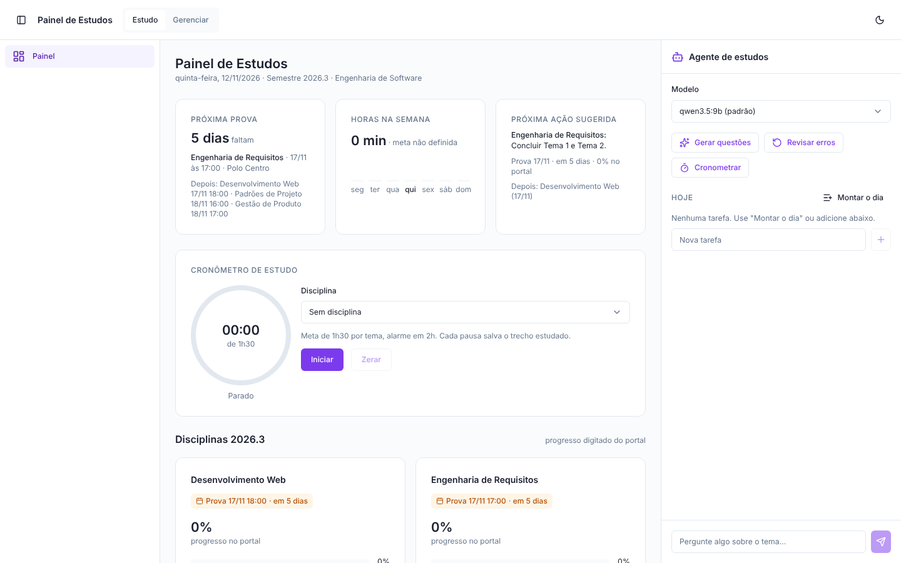
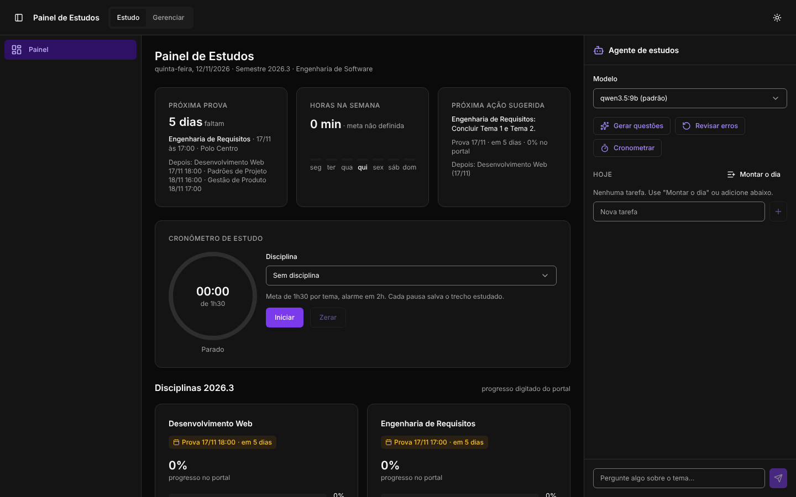
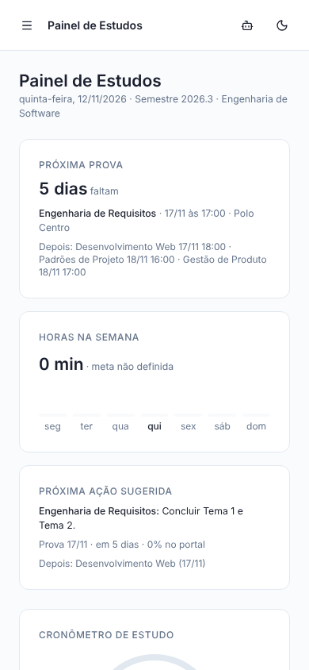
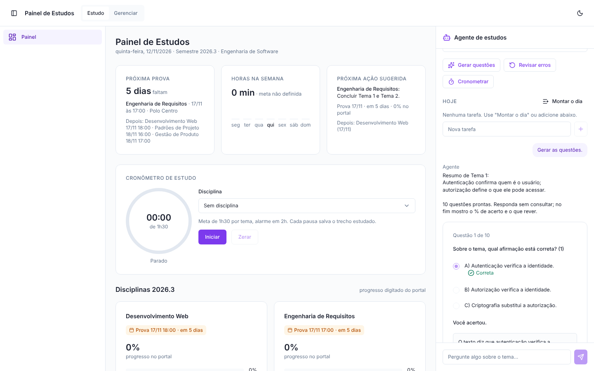
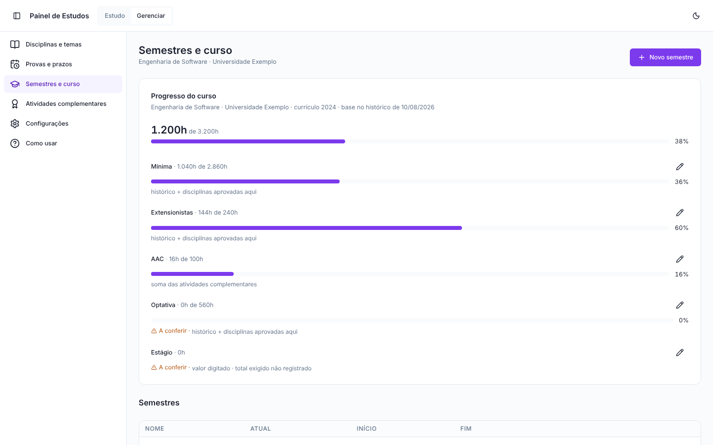
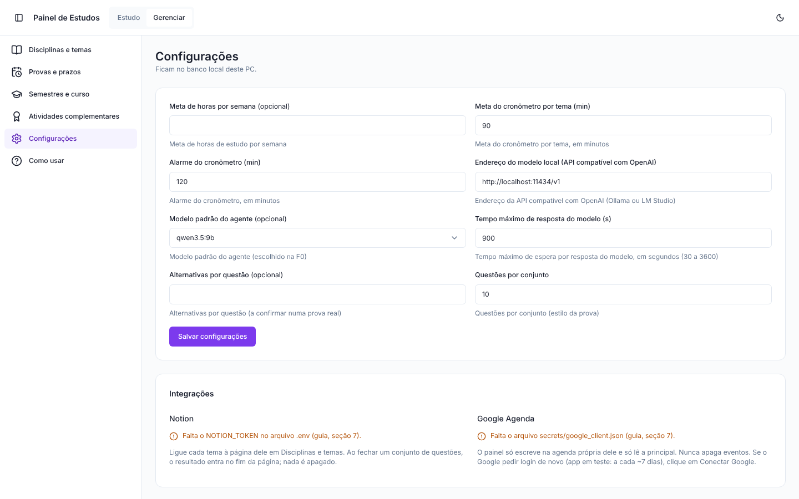

# Painel de Estudos

Painel de estudos que roda no próprio PC, com um agente de estudos movido por um modelo de linguagem **local** (LM Studio ou Ollama). Nenhum dado sai da máquina: sem nuvem, sem login, sem LLM pago.

> Esta é a **versão pública v1**, com **dados fictícios** (curso, disciplinas, provas e notas inventados). Ela só é atualizada depois de bastante uso real e de uma próxima versão do painel.



## O que ele faz

- **Painel do dia:** próxima prova com contagem regressiva, horas estudadas na semana, próxima ação sugerida e progresso de cada disciplina.
- **Cronômetro de estudo:** meta e alarme por tema, com som; cada pausa salva o trecho estudado.
- **Agente de estudos local:** gera resumos e conjuntos de questões no estilo da prova a partir do texto do tema, corrige, mostra o percentual de acerto e guarda os erros para revisão.
- **Progresso do curso:** horas por componente (mínima, extensionistas, atividades complementares, optativa, estágio).
- **Regras de avaliação como dados:** cada disciplina tem a sua regra (pesos, nota mínima, AV/AVS), sem `if` por disciplina no código.
- **Integrações opcionais:**
  - **Notion:** lê o texto do tema da página ligada e grava o resultado no fim da página (nunca apaga nada).
  - **Google Agenda:** cria as provas numa agenda própria do painel e só lê a principal (nunca apaga eventos).
- **Tema claro e escuro**, layout para celular e acessibilidade conferida com axe-core.

| Tema escuro | Celular |
| --- | --- |
|  |  |

### Agente de questões



### Progresso do curso e configurações

| Progresso do curso | Configurações e integrações |
| --- | --- |
|  |  |

## Como funciona

- **Backend:** Python 3.12, FastAPI, SQLAlchemy, Alembic e SQLite (`./data/painel.db`).
- **Frontend:** React, Vite, TypeScript e Tailwind v4, seguindo um padrão de design próprio (design system).
- **Modelo:** qualquer servidor com API compatível com OpenAI (LM Studio `:1234/v1` ou Ollama `:11434/v1`). A lista de modelos vem do servidor. Toda chamada passa por um único cliente que valida o JSON com schema Pydantic, tenta de novo uma vez e registra modelo, versão do prompt, tokens e tempo.
- **Prompts versionados** em `backend/prompts/*.md`.
- **Avaliação de modelos (F0):** `eval/run_eval.py` compara modelos locais no mesmo material; o resultado está em [`docs/F0_RESULTADO.md`](docs/F0_RESULTADO.md).

### Segurança e privacidade

- Porta presa a `127.0.0.1`: só o próprio PC acessa.
- Proteção contra DNS rebinding (lista de hosts aceitos), CSP restrita e cabeçalhos de segurança.
- Ao modelo vai só o texto do tema e as questões; notas, nomes e agenda nunca são enviados.
- Tokens só no `.env` e em `./secrets/`, os dois fora do git.

## Rodar

Requisitos: Docker Desktop e, para o agente, o LM Studio ou o Ollama com um modelo baixado.

```powershell
docker compose up --build
```

Abra `http://localhost:8000` (documentação da API em `http://localhost:8000/docs`). No primeiro início o container cria o banco, aplica as migrações e carrega os dados fictícios de demonstração. Para começar do zero, pare o container e apague `./data/painel.db`.

Passo a passo para iniciantes, com prints: [`docs/GUIA.md`](docs/GUIA.md) (também em PDF: [`docs/guia/GUIA.pdf`](docs/guia/GUIA.pdf), e no app em Gerenciar → Como usar).

### Desenvolver sem Docker

```powershell
cd backend
python -m venv .venv; .venv\Scripts\activate
pip install -r requirements-dev.txt
alembic upgrade head; python -m app.seed
uvicorn app.main:app --reload --port 8000
pytest
```

```powershell
cd frontend
npm install
npm run dev   # encaminha /api para a porta 8000
```

## Estrutura

- `backend/app/` — API, modelos, motor das regras de avaliação, agente, integrações e carga inicial
- `backend/migrations/` — migrações do Alembic
- `backend/prompts/` — prompts versionados do agente
- `backend/tests/` — testes (pytest)
- `frontend/` — interface React
- `eval/` — avaliação de modelos locais (F0)
- `docs/` — guia, prints e resultado da F0
- [`SPEC.md`](SPEC.md) — escopo, decisões e fases · [`CLAUDE.md`](CLAUDE.md) — regras para quem programa

## Autor

**Micael Fabri** ([@micaelfabri](https://github.com/micaelfabri)): concepção do produto, especificação ([`SPEC.md`](SPEC.md)), escolha da stack e da arquitetura, padrão de design, requisitos de segurança e privacidade, avaliação dos modelos locais e validação em uso real.

O código foi desenvolvido com IA (Claude Code), sob direção e revisão do autor, seguindo o SPEC e as regras do projeto ([`CLAUDE.md`](CLAUDE.md)).

Os dados de demonstração são fictícios: troque pelos seus em Gerenciar.
