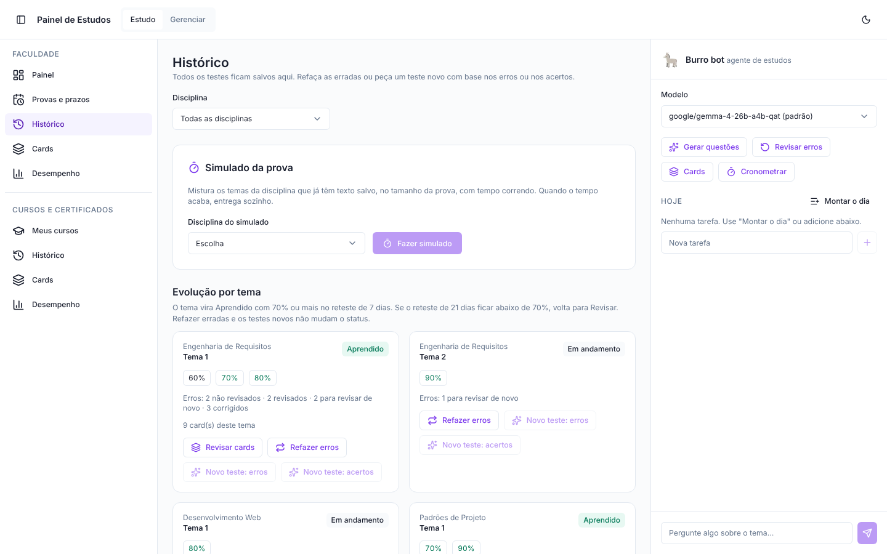
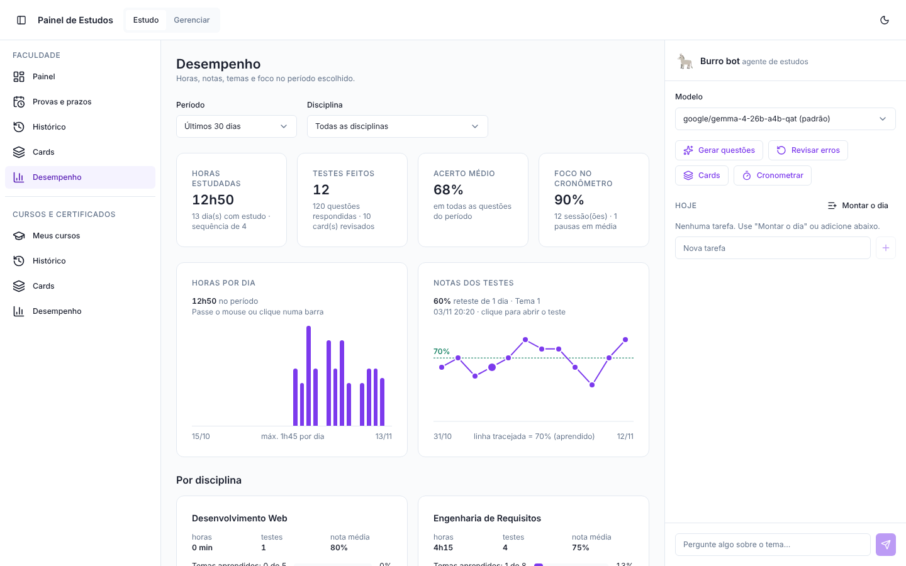
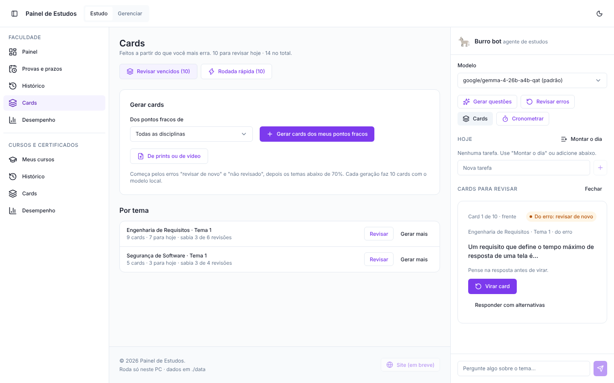
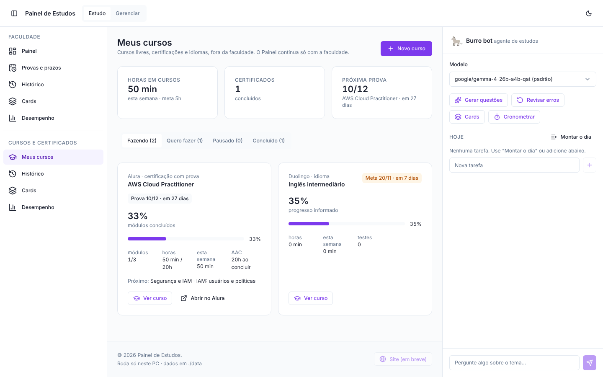
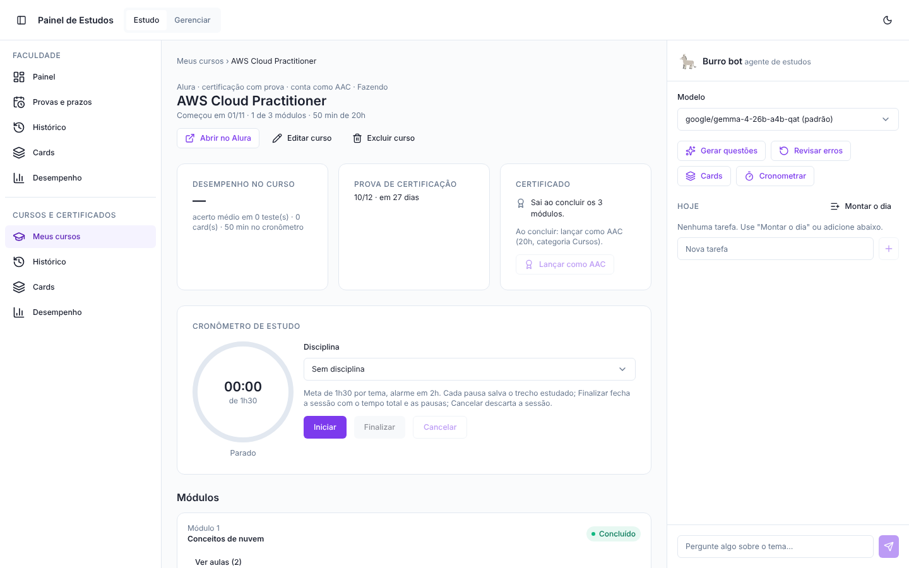

# Painel de Estudos

Faço uma graduação EAD, e estudar um único tema me tomava de 3 a 6 horas: abrir o portal, assistir às videoaulas, tirar prints, copiar tudo para o Notion. Minha rotina só comporta um tema por dia. Mesmo assim, eu não sabia o quanto estava aprendendo de verdade, perdia o ritmo depois de umas semanas parado e não tinha, em lugar nenhum, uma visão única de provas, prazos e do quanto falta para me formar.

Então decidi construir a ferramenta que eu precisava: um painel que roda no meu próprio PC, com um agente de estudos que transforma o conteúdo de cada tema em resumo e questões no estilo da prova, corrige as minhas respostas e agenda as revisões. A medida de sucesso que defini não é quantas horas eu estudei, e sim se eu aprendi: um tema só conta como **aprendido** quando eu acerto 70% ou mais na revisão de 7 dias.

> Esta é a **versão pública v1.8**, com **dados fictícios** (curso, disciplinas, provas, notas e atividade de estudo inventados). A versão que eu uso no dia a dia fica privada, com os meus dados reais. Esta cópia é atualizada depois de um bom tempo de uso de cada nova versão.


## As decisões que guiaram o projeto

- **Tudo local.** Minhas notas, minha agenda e o material das disciplinas não saem do meu PC. Por isso o agente usa um modelo de linguagem rodando na minha própria máquina (LM Studio ou Ollama): sem nuvem, sem login, sem pagar por IA.
- **No PC, não no celular.** Aplicativo no celular me distrai; o painel abre no navegador do computador onde eu já estudo.
- **Medir aprendizado, não tempo.** Cada tema ganha uma nota na primeira tentativa e revisões em 1, 7 e 21 dias.
- **Escolher o modelo com dados, não com achismo.** Antes de definir qual modelo usar, testei quatro modelos locais com o mesmo material (detalhes abaixo).

## O que ele faz

- **Painel do dia:** próxima prova com contagem regressiva, horas estudadas na semana, a próxima ação sugerida (prova mais perto × menor progresso × revisões pendentes), o card do dia, a faixa dos próximos 14 dias e o progresso de cada disciplina com a **nota prevista** (o que já tenho e quanto falta na prova para passar).
- **Cronômetro de estudo:** meta e alarme por tema, com som. Cada sessão guarda o tempo estudado, o tempo total e quantas pausas eu fiz.
- **Burro bot, o agente de estudos:** a partir do texto do tema, gera resumo e questões no formato da prova, corrige, mostra o percentual de acerto e guarda os erros para revisar depois. Também conversa sobre o tema (a conversa fica salva) e monta o checklist do dia.
- **Ciclo dos erros:** cada erro passa por não revisado → revisado → corrigido (ou revisar de novo). Dá para refazer só as erradas, pedir um teste novo com base nos erros e fazer um simulado da prova com tempo.
- **Cards de estudo:** feitos a partir do que eu mais erro, dos prints das minhas respostas e de transcrições de vídeo. Respondo com 4 alternativas ou viro o card; cada card volta em 1, 7, 21 e 60 dias. Tem rodada rápida e card do dia.
- **Histórico e Desempenho:** todo teste fica salvo; gráficos interativos de horas por dia e notas ao longo do tempo, por período e por disciplina.
- **Provas e prazos:** provas, labs, atividades e simulados numa lista só, com o resultado lido dos prints das minhas respostas (o modelo só propõe; eu confirmo).
- **Cursos e certificados:** cursos fora da faculdade (livres, certificações, idiomas) num grupo próprio, com módulos e aulas, questões, cards e cronômetro por curso. As horas têm meta separada, a prova de certificação fica só ali e, quando o curso conta como atividade complementar, as horas são lançadas com um clique ao concluir.
- **Progresso do curso:** horas por componente (mínima, extensionistas, atividades complementares, optativa, estágio).
- **Regras de avaliação como dados:** cada disciplina tem a sua regra (pesos, nota mínima), sem `if` por disciplina no código.
- **Integrações opcionais:**
  - **Notion:** lê o texto do tema direto da página onde eu já faço as minhas anotações e grava o resultado no fim dela (nunca apaga nada).
  - **Google Agenda:** cria as provas numa agenda própria do painel e só lê a principal (nunca apaga eventos).
- **Tema claro e escuro**, layout para celular e acessibilidade conferida com axe-core.

| Tema escuro | Celular |
| --- | --- |
|  |  |

### Agente de questões


### Histórico, desempenho e cards

| Histórico | Desempenho |
| --- | --- |
|  |  |



### Cursos e certificados

| Meus cursos | Página de um curso |
| --- | --- |
|  |  |

### Progresso do curso e configurações

| Progresso do curso | Configurações e integrações |
| --- | --- |
|  |  |

## Como escolhi o modelo

Rodei a mesma tarefa em quatro modelos locais, na minha GPU de 8 GB: 5 módulos reais de uma disciplina de segurança, 10 questões com 5 alternativas cada, um modelo carregado por vez.

| Modelo | Tempo médio por conjunto | Seguiu o formato? | Minha nota |
| --- | --- | --- | --- |
| gemma-4-26b-a4b-qat | ~2 min 50 s | Sim | **5** |
| gemma-4-12b-qat | ~4 min 20 s | Sim | 4 |
| gemma-4-e4b | ~47 s | Não (um conjunto veio incompleto) | 4 |
| qwen3.5-9b | ~70 s | Não (4 alternativas, resposta certa na letra A em 82% das vezes) | 3 |

O teste mostrou problemas que eu não teria visto só usando: modelo devolvendo menos questões que o pedido e resposta certa quase sempre na mesma letra. Isso virou correção no painel: agora ele exige exatamente o número de questões e de alternativas pedido e embaralha as alternativas. Fiquei com o `gemma-4-26b-a4b-qat` como padrão. Resultado completo: [`docs/F0_RESULTADO.md`](docs/F0_RESULTADO.md).

## Como foi construído

Eu escrevi o [`SPEC.md`](SPEC.md) com o problema, as decisões e as fases (F0 a F7), e defini as regras do projeto no [`CLAUDE.md`](CLAUDE.md). O código foi desenvolvido com IA (Claude Code), fase por fase: cada mudança passou pela minha revisão e por testes antes de entrar, e eu usei o painel de verdade nos meus estudos para validar cada etapa.

- **Backend:** Python 3.12, FastAPI, SQLAlchemy, Alembic e SQLite (`./data/painel.db`).
- **Frontend:** React, Vite, TypeScript e Tailwind v4, seguindo um padrão de design próprio.
- **Modelo:** qualquer servidor com API compatível com OpenAI (LM Studio `:1234/v1` ou Ollama `:11434/v1`). Toda chamada passa por um único cliente que valida o JSON com schema Pydantic, tenta de novo uma vez e registra modelo, versão do prompt, tokens e tempo.
- **Prompts versionados** em `backend/prompts/*.md`.

### Segurança e privacidade

Antes de publicar cada versão, faço uma auditoria de segurança com um roteiro próprio e um checklist de pré-publicação. Os relatórios estão em [`docs/security-audit/`](docs/security-audit/). Todo pull request roda os testes no GitHub Actions (ruff e pytest no backend; TypeScript, vitest e build no frontend).

- Porta presa a `127.0.0.1`: só o próprio PC acessa.
- Proteção contra DNS rebinding, bloqueio de escrita vinda de outros sites, CSP restrita e cabeçalhos de segurança.
- Container rodando sem root.
- Ao modelo vai o texto do tema e as questões. Os prints das minhas respostas e um resumo curto dos meus números de estudo só vão para o modelo **local**, e o resumo dá para desligar em Configurações. Nada vai para IA na nuvem.
- Tokens só no `.env` e em `./secrets/`, os dois fora do git.

## Rodar

Requisitos: Docker Desktop e, para o agente, o LM Studio ou o Ollama com um modelo baixado.

```powershell
docker compose up --build
```

Abra `http://localhost:8000` (documentação da API em `http://localhost:8000/docs`). No primeiro início o container cria o banco, aplica as migrações e carrega os dados fictícios de demonstração. Para começar do zero, pare o container e apague `./data/painel.db`. Depois é só trocar pelos seus dados em **Gerenciar**.

Passo a passo para iniciantes, com prints: [`docs/GUIA.md`](docs/GUIA.md) (também em PDF: [`docs/guia/GUIA.pdf`](docs/guia/GUIA.pdf), e no app em Gerenciar → Como usar).

### Desenvolver sem Docker

```powershell
cd backend
python -m venv .venv; .venv\Scripts\activate
pip install -r requirements-dev.txt
alembic upgrade head; python -m app.seed
uvicorn app.main:app --reload --port 8000
pytest
```

```powershell
cd frontend
npm install
npm run dev   # encaminha /api para a porta 8000
```

## Estrutura

- `backend/app/` — API, modelos, motor das regras de avaliação, agente, integrações e carga inicial
- `backend/migrations/` — migrações do Alembic
- `backend/prompts/` — prompts versionados do agente
- `backend/tests/` — testes (pytest)
- `frontend/` — interface React
- `eval/` — teste de modelos locais (F0)
- `docs/` — guia, prints, resultado da F0 e auditorias de segurança
- `.github/workflows/ci.yml` — testes em todo pull request

## Créditos das imagens

O burro do Burro bot é o emoji animado do Noto, do Google (licença CC BY 4.0). Detalhes em [`frontend/public/CREDITOS-IMAGENS.md`](frontend/public/CREDITOS-IMAGENS.md).

## Autor

**Micael Fabri** ([@micaelfabri](https://github.com/micaelfabri)): concepção do produto, especificação, escolha da stack e da arquitetura, padrão de design, requisitos de segurança e privacidade, teste dos modelos locais e validação em uso real.
